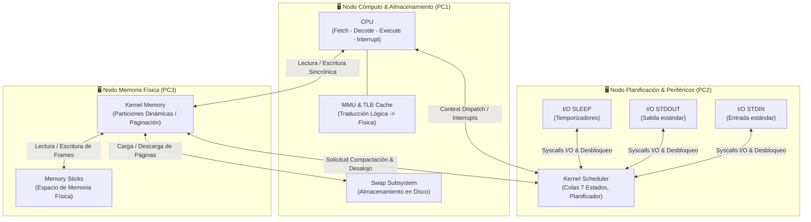

# 🖥️ Simulador de Kernel y Sistema Operativo Distribuido — "Plug & Pray"

<div align="center">

  
  
  
  
  
  

  <br><br>
  <b>Simulación integral de un Sistema Operativo Unix-like distribuido en red TCP/IP</b><br>
  <i>Implementado en lenguaje C bajo estándares de concurrencia POSIX, multiprocesamiento, gestión de memoria virtual con paginación/swap, y planificación multinivel con interrupciones de hardware.</i>
</div>

---

## 📌 Descripción del Proyecto

**Plug & Pray** es un sistema distribuido desarrollado en lenguaje **C** que emula con precisión el funcionamiento interno de un sistema operativo moderno y su interacción con hardware simulado.

El sistema modela una infraestructura distribuida desacoplada en nodos independientes comunicados mediante **Sockets TCP/IP**, implementando capas de abstracción para hardware de bajo nivel (CPU con MMU y TLB, módulos de memoria RAM física, espacio de almacenamiento Swap) y subsistemas centrales del kernel (planificador de procesos en 7 estados, drivers de dispositivos periféricos de I/O y serialización binaria idempotente).

El desarrollo fue realizado para la materia **Sistemas Operativos** en la **Universidad Tecnológica Nacional (UTN - FRBA)** por el equipo **"El Último Paradigma"**.

---

## 🏗️ Arquitectura Distribuida y Topología de Red

El sistema opera dividiendo sus responsabilidades en procesos de red independientes que pueden ejecutarse en una única máquina o distribuidos a través de múltiples nodos físicos (PC1, PC2, PC3):



### Protocolo de Red e Intercomunicación
- **Sockets TCP/IP no bloqueantes:** Manejo de clientes concurrentes con hilos dedicados y buffers de conexión.
- **Serialización Binaria Idempotente:** Capa compartida (`utils/protocolo`) que empaqueta encabezados con códigos de operación (`opcodes.h`), tamaño del payload y deserialización defensiva mediante `t_buffer_reader`, garantizando protección estricta contra *Buffer Overflows*.
- **Manejo de Errores y Reconexión:** Logging transaccional de estados de conexión, rechazo defensivo ante parámetros inválidos y limpieza segura de descriptores de archivo (`close`).

---

## ⚙️ Subsistemas y Componentes Centrales

### 1. Planificador de Procesos (`kernel_scheduler`)
Controla el ciclo de vida del Proceso mediante un **Process Control Block (PCB)** con identificación de PID, Program Counter (PC), registros de propósito general, tabla de páginas/segmentos, métricas de ráfaga y estado de ejecución.

- **Modelo de 7 Estados:**
  - `NEW`: Admisión al sistema (FIFO).
  - `READY`: Procesos listos para consumir quantum de CPU.
  - `EXEC`: Proceso asignado a la CPU (validación $O(1)$).
  - `BLOCK`: Espera de eventos de I/O o recursos compartidos.
  - `SUSP_READY` / `SUSP_BLOCK`: Procesos suspendidos a mediano plazo liberando memoria principal.
  - `EXIT`: Destrucción controlada, recolección de estadísticas y liberación de recursos.
- **Algoritmos de Planificación Implementados:**
  - **FIFO (First In, First Out)**: Planificación no expropiativa por orden estricto de llegada.
  - **Round Robin (RR)**: Planificación expropiativa con interrupción periódica por fin de Quantum.
  - **Virtual Round Robin (VRR)**: Optimización con cola de prioridad para procesos retornados de E/S antes del agotamiento del quantum, compensando solo el remanente no utilizado de la ráfaga.
- **Hilos del Kernel:** Desacoplamiento entre el *Dispatcher* (despacho a CPU) y el *Interruptor* (emisión asincrónica de señales de desalojo).

### 2. Unidad Central de Procesamiento (`cpu`)
Emulador del ciclo de instrucción del hardware:
1. **Fetch:** Obtención de la próxima instrucción según el `PC` consultando a Memoria.
2. **Decode:** Decodificación léxica de la instrucción (`SET`, `MOV_IN`, `MOV_OUT`, `IO`, `F_OPEN`, `EXIT`, etc.).
3. **Execute:** Modificación de registros (`AX`, `BX`, `CX`, `DX`, `EAX`, etc.) o invocación a syscalls.
4. **Check Interrupt:** Comprobación no bloqueante del canal de interrupción para atender órdenes de desalojo por fin de quantum o eventos de compactación.
- **MMU (Memory Management Unit) y TLB:**
  - Traducción dinámica de Direcciones Lógicas a Direcciones Físicas.
  - Caché TLB de alta velocidad para reducir el overhead de acceso a memoria, con algoritmos de reemplazo de entradas (FIFO y LRU).

### 3. Gestión de Memoria y Paginación (`kernel_memory` & `memory_stick`)
- **Espacio Físico Segmentado/Paginado:** Representación de memoria real en marcos (frames).
- **Asignación Dinámica:** Implementación de estrategias de ubicación libre:
  - **First-Fit:** Asignación en el primer hueco contiguo con capacidad suficiente.
  - **Best-Fit:** Búsqueda del hueco que minimice el desperdicio de memoria.
- **Compactación Dinámica:** Algoritmo de desfragmentación de memoria principal. Cuando se produce fragmentación externa que impide alojar un nuevo proceso, Kernel Memory solicita al Scheduler el desalojo coordinado del proceso activo en CPU, compacta el espacio físico y reubica los punteros de base.
- **Single Source of Truth:** Kernel Memory actúa como única fuente de verdad sobre el mapeo de memoria física, evitando *race conditions* con CPU.

### 4. Subsistema de Swap (`swap`)
- Archivo binario en disco que almacena bloques de memoria paginados fuera de la RAM física.
- Transferencia asíncrona de páginas entre memoria primaria y disco para satisfacer solicitudes de procesos suspendidos o páginas desalojadas.

### 5. Interfaces de Entrada/Salida (`io`)
- Controladores independientes para dispositivos periféricos (`STDIN`, `STDOUT`, `SLEEP`).
- Procesamiento en paralelo de peticiones de entrada de usuario o esperas activas sin bloquear el ciclo de procesamiento de la CPU.

---

## 🔒 Concurrencia, Sincronización y Clean Code

- **Hilos POSIX (`pthread`):** Ejecución concurrente de listeners de sockets, temporizadores de quantum y rutinas de atención de periféricos.
- **Semáforos y Mutexes:**
  - Exclusión mutua estricta con `pthread_mutex_t` en el acceso a colas de planificación, estructuras compartidas y memoria.
  - Semáforos contadores (`sem_t`) para señalización inter-hilos (ej. notificación de procesos en estado NEW listos para admisión).
- **Prevención de Deadlocks y Race Conditions:**
  - Protocolo riguroso de adquisición ordenada de locks.
  - Resolución de condiciones de carrera críticas en el *dispatcher* del scheduler ante desincronización de desconexión de clientes y expiración de ráfagas.
- **Gestión Defensiva de Memoria en C:**
  - Mitigación activa de memory leaks mediante liberación exhaustiva de punteros (`free`), destrucción ordenada de PCBs y validación con `Valgrind`.

---

## 📂 Estructura del Repositorio

```text
├── cpu/                  # Módulo CPU: Ciclo de instrucción, decodificador, MMU y TLB
│   ├── src/              # Código fuente (ciclo_instruccion.c, cpu_memoria.c, mmu.c)
│   ├── tests/            # Tests unitarios de instrucciones y traducción de direcciones
│   └── configs/          # Archivos de configuración y variables de entorno
├── kernel_scheduler/     # Módulo Kernel: Planificador 7 estados, colas, dispatcher
│   ├── src/              # Colas, PCB, planificador, comunicación de red
│   ├── tests/            # Tests de algoritmos de planificación (RR, VRR, FIFO)
│   └── configs/          # Configuraciones de pruebas (PCP, Memoria, E/S)
├── kernel_memory/        # Módulo Memoria: Asignación dinámica, compactación, marcos
│   ├── src/              # Gestión de huecos, clientes y compactación
│   └── tests/            # Suite de tests de memoria y deserialización
├── memory_stick/         # Emulación de módulos físicos de memoria RAM
├── swap/                 # Subsistema de almacenamiento secundario en disco
├── io/                   # Drivers de periféricos independientes (STDIN, STDOUT, SLEEP)
├── utils/                # Biblioteca compartida: Protocolo binario, sockets, logging
│   └── src/utils/        # Estructuras de dominio, serialización, wrappers de socket
├── _notas_y_guias/       # Documentación técnica interna y justificación de diseño
│   ├── Decisiones_Disenio/ # Justificación de 7 estados, compactación y dispatcher
│   ├── explicaciones_conceptos/ # Auditorías de CPU, desalojos y arquitectura de red
│   └── Testeo_Unitario/  # Guías de testing con CSpec y asserts
├── CODIGO_EJECUCION.txt  # Comandos de orquestación y topologías de prueba
└── Makefile              # Reglas de compilación automatizadas
```

---

## 🚀 Compilación y Ejecución

### Prerrequisitos
- Sistema Operativo: **Linux (Ubuntu 22.04 LTS o superior)**
- Compilador: **GCC (soporte estándar C99/C11)**
- Herramienta de compilación: **GNU Make**
- Biblioteca compartida: [so-commons-library](https://github.com/sisoputnfrba/so-commons-library)

```bash
# 1. Clonar e instalar las commons de la cátedra
git clone https://github.com/sisoputnfrba/so-commons-library
cd so-commons-library
make debug
sudo make install
cd ..
```

### Compilación Modular
Cada subsistema posee su propio `Makefile` optimizado:

```bash
# Compilar biblioteca compartida utils
cd utils && make && cd ..

# Compilar módulos principales
cd cpu && make && cd ..
cd kernel_scheduler && make && cd ..
cd kernel_memory && make && cd ..
cd swap && make && cd ..
cd io && make && cd ..
```

### Ejecución en Modo Distribuido (Ejemplo Prueba Base)
Siguiendo las especificaciones de topología multi-máquina definidas en `CODIGO_EJECUCION.txt`:

```bash
# Terminal 1 - Memoria Física (PC3)
./kernel_memory/bin/kernel_memory ./kernel_memory/configs/prueba_base.config

# Terminal 2 - CPU & Swap (PC1)
./swap/bin/swap ./swap/configs/swap.config
./cpu/bin/cpu ./cpu/configs/cpu.config CPU_1

# Terminal 3 - Kernel Scheduler & Periféricos (PC2)
./kernel_scheduler/bin/kernel_scheduler ./kernel_scheduler/configs/prueba_base.config PLANI_PRE_0.prc
./io/bin/io ./io/configs/io.config STDIN &
./io/bin/io ./io/configs/io.config STDOUT &
./io/bin/io ./io/configs/io.config SLEEP &
```

---

## 🧪 Pruebas Unitarias y Calidad de Código

El repositorio cuenta con suites de pruebas unitarias automáticas basadas en la biblioteca **CSpec** y aserciones directas para validar componentes aislados:
- **Pruebas de MMU y Paginación:** Verificación matemática de traslación de offsets y números de página.
- **Pruebas de Planificador:** Simulación determinística de ráfagas de tiempo para algoritmos Round Robin y desempate de prioridades.
- **Pruebas de Deserialización:** Validación contra buffers truncados o paquetes maliciosos en la capa de red.

Para ejecutar los tests de cualquier módulo:
```bash
cd cpu && make test && ./bin/tests
```

---

## 👥 Equipo de Desarrollo

Proyecto desarrollado por el grupo **"El Último Paradigma"** — Sistemas Operativos (UTN-FRBA):
- **Máximo Hidalgo** ([@MaximoHidalgo](https://github.com/MaximoHidalgo)) — *Líder técnico de integración, Kernel Scheduler, Concurrencia/Deadlocks y MMU.*
- *Colaboradores del equipo:* David Quenallata, Máximo Pisciottano, Luca Tanner, Elian Spalletti, Dylan Gonzalez.

---

<div align="center">
  <sub>Facultad Regional Buenos Aires — Universidad Tecnológica Nacional (UTN-FRBA)</sub>
</div>
